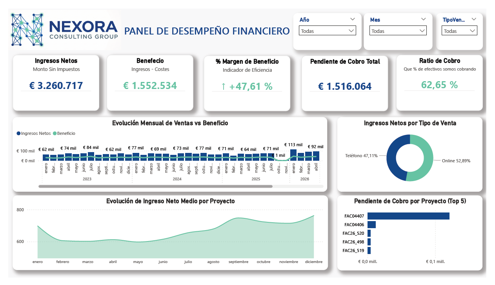
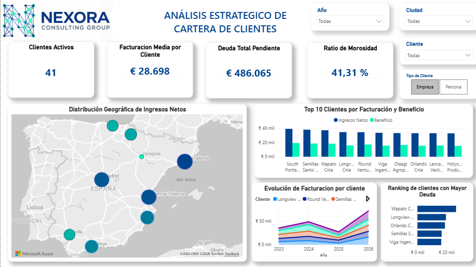
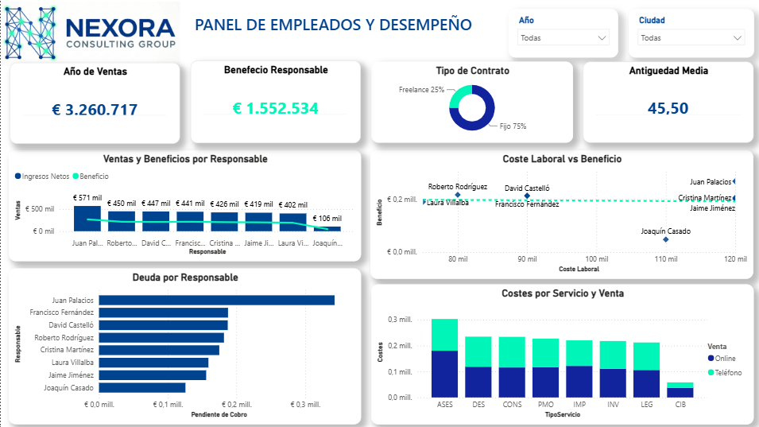

# powerbi-financial-dashboard

Cuadro de mando en Power BI para una consultora ficticia (Nexora Consulting Group), construido a partir de datos en Excel con errores que tuve que limpiar y modelar.

Desarrollado durante el Curso de Especialización en IA y Big Data — Instituto Nebrija (2026). **Todos los datos, nombres y la marca son ficticios.**

## Qué incluye

| Panel | Qué responde |
|---|---|
| Desempeño financiero | Ingresos netos, beneficio, margen (47,6 %), pendiente de cobro y ratio de cobro (62,7 %); evolución mensual 2023–2026 y reparto por tipo de venta |
| Cartera de clientes | Clientes activos, facturación media por cliente, deuda pendiente, ratio de morosidad (41,3 %), top 10 clientes y mapa de ingresos por ciudad |
| Empleados y desempeño | Ventas y beneficio por responsable, deuda por responsable, coste laboral frente a beneficio y costes por tipo de servicio |

Los tres paneles tienen filtros dinámicos (año, mes, ciudad, cliente y tipo de venta o de cliente).

## Mi trabajo

- Limpieza de los datos de origen en Excel: duplicados, formatos de fecha, valores nulos.
- Modelo de datos y relaciones entre tablas.
- Medidas y KPIs: margen de beneficio, ratio de cobro, ratio de morosidad, facturación media por cliente.
- Diseño de los paneles y de la navegación.

## Herramientas

Power BI Desktop · Excel · Power Query / DAX

## Capturas

## Autor

Victor Castillo Jiménez
